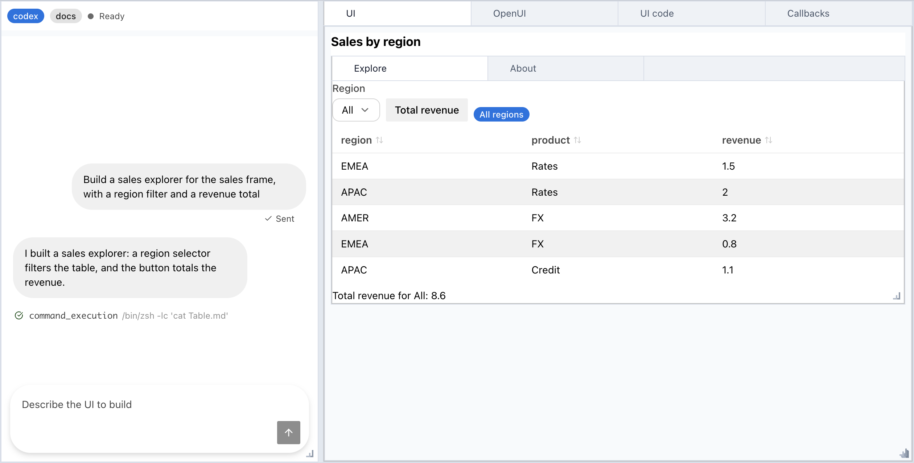
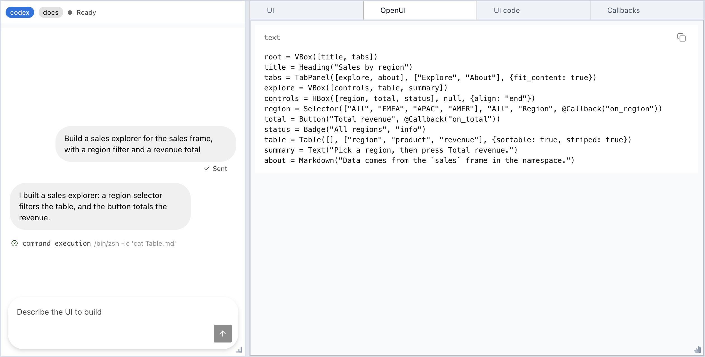
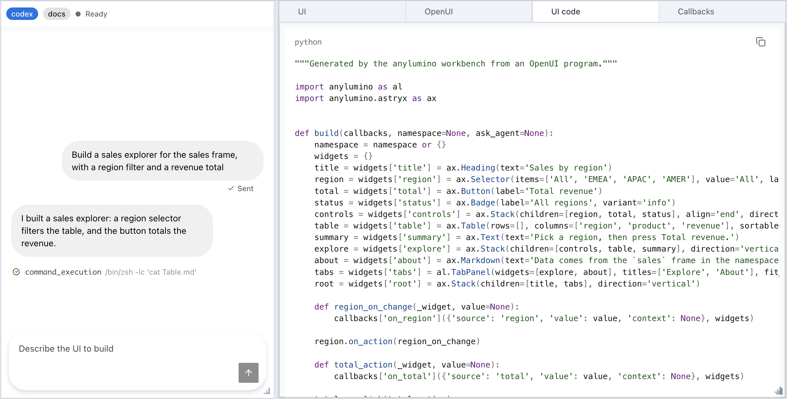
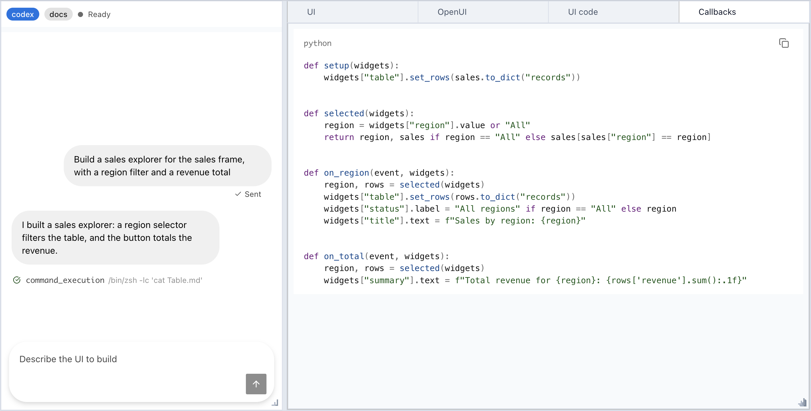

`anylumino.workbench.Workbench` builds notebook UIs through a chat with a local
coding agent. The chat sits on the left. The right side has four tabs: the live
UI, the [OpenUI Lang](https://github.com/thesysdev/openui) program the agent
wrote, the Python generated from that program, and the agent's callbacks.



## Requirements

- `node` on `PATH`. The workbench parses OpenUI programs with the bundled
  `@openuidev/lang-core` tool.
- The `claude` (Claude Code) or `codex` (Codex CLI) executable on `PATH`,
  signed in.

## Start a workbench

```python
import pandas as pd
from anylumino.workbench import Workbench

sales = pd.DataFrame({"region": ["EMEA", "APAC", "AMER"], "revenue": [1.5, 2.0, 3.2]})

Workbench(agent="claude", session="sales", namespace={"sales": sales})
```

Ask for a UI in the chat, for example "Show the sales table with a region
selector and a button that totals the selected region". Each reply can change
the program, the callbacks, or both.

| Argument    | Effect                                                                                  |
| ----------- | --------------------------------------------------------------------------------------- |
| `agent`     | `"claude"` or `"codex"`. A restored session keeps the agent it was created with.         |
| `session`   | Saves the session after every turn and restores it when a workbench uses the same name. |
| `namespace` | Names the callbacks can read and the agent sees, with data frame shapes and columns.     |
| `cwd`       | Directory the agent runs in. Defaults to the current directory.                          |

## Tabs

| Tab         | Shows                                                               |
| ----------- | ------------------------------------------------------------------- |
| `UI`        | The widgets built by the generated code.                            |
| `OpenUI`    | The program after the reply's edits were merged into it.            |
| `UI code`   | The Python module that builds the `UI` tab. The tab runs this code. |
| `Callbacks` | The Python handlers from the agent's latest `python` block.         |

The code tabs are read only. Only chat turns change them.





A turn is applied in full or not at all. The workbench merges and parses the
program, compiles the callbacks, generates the UI code, and builds the widgets.
If any step fails, all four tabs keep their previous content, and the chat shows
the error. The agent also gets the error with the next message.

## Callbacks

The program binds events with `@Callback(handler, context?)`: a button's action
runs on click, and an input's `on_change` runs when its value changes. The
handler receives the event and the widgets by statement name:

```python
def on_total(event, widgets):
    region = widgets["region"].value
    total = sales.loc[sales["region"] == region, "revenue"].sum()
    widgets["result"].text = f"{region}: {total}"
```

- `event` has `source` (the statement name), `value` (the new value, or `None`
  for a button), and `context` (the second `@Callback` argument).
- Callbacks run in the kernel with the `namespace` names as globals.
- An optional `setup(widgets)` runs each time the UI is built. The agent uses it
  to fill tables and selectors from namespace data, for example with
  `widgets["table"].set_rows(sales.to_dict("records"))`. The agent sees only
  the shape and columns of a data frame, so its rows never leave the kernel.
- `ask_agent(message, context=None)` sends a chat message from a handler.
  `@ToAssistant(message)` in the program does the same without a handler.
- `Widget("name")` in the program mounts the widget stored under `name` in the
  `namespace`, such as a Plotly `FigureWidget`.
- An exception in a handler shows in the chat. The other widgets keep working.



<Callout type="warn" title="Warning">
  The workbench runs agent-written Python in your kernel: the callbacks and the
  generated UI code. Read the code tabs before you use a generated UI on data
  or systems that matter.
</Callout>

## Agent access

Each turn runs the CLI as a subprocess, so the kernel stays responsive. Only one
turn runs at a time, and the stop control in the chat ends it. The agent can
read files in `cwd` but not change them:

- Claude runs with only the `Read`, `Grep`, `Glob`, and `Skill` tools, all
  allowed without a prompt, and `--permission-mode dontAsk`.
  `--strict-mcp-config` keeps your MCP servers out of the turn.
- Codex runs in its `read-only` sandbox. The sandbox does not cover MCP tools,
  so each turn turns off every server that `codex mcp list` reports. If a
  server cannot be turned off, the turn does not start.

## Component options

Most components end with an optional `options` object that sets more keyword
arguments of the widget, for example
`Table(rows, ["region", "revenue"], {sortable: true, density: "compact"})`. The
options come from the widget constructors, so the workbench accepts the same
names and types. An unknown option or a value of the wrong type stops the turn
from applying, and the chat shows the error.

The agent looks options up in the `openui-components` skill, which the workbench
ships in `anylumino/workbench/plugin/`. Claude loads it as a plugin for each
turn. Codex reads the same files by the path in its system prompt. After you
change a widget's keywords, run `make workbench-skill` to regenerate the skill.

## Sessions

A named session is saved to `~/.anylumino/sessions/<session>.json` with the
messages, program, callbacks, working directory, and the agent's session ID. A
new `Workbench(session="<session>")` restores all four tabs and resumes the
agent's own session, so the agent still has the earlier conversation. If the
saved UI cannot be built, for example because a mounted widget is missing from
the new `namespace`, the `UI` tab shows the error and the chat stays usable.

## How it works

This section is for maintainers. The modules are in `src/anylumino/workbench/`.

### One turn

```text
chat submit (ax.Chat)
  -> agents.py    run claude or codex as a subprocess, stream text and tool rows into the chat
  -> reply.py     split the reply into prose, one openui fence, and one python fence
  -> openui.py    merge the openui fence into the current program, then parse it (Node)
  -> exec         run the callbacks module with the namespace names as globals
  -> codegen.py   turn the parsed tree into a Python module with build(callbacks, namespace, ask_agent)
  -> exec build   create the widgets and bind each @Callback to its handler
  -> commit       set the four tabs and swap the UI tab child
  -> session.py   save the session file
```

Every step before the commit writes only to local variables. This is what makes
a failed turn leave all four tabs unchanged.

### Modules

| Module                | Role                                                                                                                                          |
| --------------------- | --------------------------------------------------------------------------------------------------------------------------------------------- |
| `catalog.py`          | Defines the components the agent can use: props, child slots, action slots, and the event of each action slot. Emits the OpenUI library spec. |
| `prompt.py`           | Builds the system prompt from the catalog with the OpenUI prompt generator, and adds the callback contract and the namespace summary.         |
| `skill.py`, `plugin/` | Write and hold the `openui-components` skill, one file per component with its options.                                                        |
| `openui.py`           | Runs `static/openui/openui_tool.bundle.mjs` under Node with JSON on stdin and stdout, for `parse`, `merge`, and `prompt`.                     |
| `reply.py`            | Splits a reply and rejects a reply with two fences of the same kind.                                                                          |
| `codegen.py`          | Emits deterministic Python, children before parents, and raises a named error for dynamic props and unsupported features.                     |
| `agents.py`           | Builds the CLI arguments, parses the Claude and Codex event streams, and stops a turn.                                                        |
| `session.py`          | Saves and loads sessions with an atomic write, and validates session names.                                                                   |
| `workbench.py`        | Assembles the panels and runs the turn.                                                                                                       |

The frontend parts are `ax.Chat` in `static/astryx/astryx_widget.js` and the
layout code in `static/layout/`. `scripts/openui_tool.mjs` is the source of the
OpenUI bundle; `npm run build` bundles it.

### Design decisions

- **OpenUI Lang:** it has a specification, a parser, a prompt generator, and an
  edit mode, so the workbench does not define its own format. The workbench
  merges every `openui` fence into the current program. A follow-up turn sends
  only the statements that changed, and a full program merges to itself.
- **The official parser under Node:** `@openuidev/lang-core` is TypeScript only.
  Parsing in the browser would need a rendered view, so session restore before
  display and headless tests would fail. A Python port is about 2.2k lines to
  keep in sync. `@openuidev/lang-core` and `zod` are pinned to exact versions,
  and `node --test` runs the bundle against OpenUI conformance fixtures in
  `tests/frontend/fixtures/openui/`.
- **Generated code, not an interpreter:** the `UI` tab is built by executing the
  module in the `UI code` tab, so the two cannot differ. The module also runs
  without the workbench.
- **The catalog is Python:** it sits next to the widget classes, and prop names
  match the constructor keywords. A test builds every entry, so a renamed
  keyword fails it. The catalog `VBox` and `HBox` build `ax.Stack`, not Lumino
  boxes: Lumino boxes split the height evenly between their children and clip
  tables and text.
- **Options in a skill:** the options of all components would roughly double
  the system prompt, so the prompt lists only the component signatures. Claude
  loads the skill with `--plugin-dir`. Codex has no per-run skill path, so its
  prompt gives the absolute path of the skill files.
- **Agent sessions:** the workbench creates the Claude session ID and passes it
  with `--session-id`, because `-n` cannot be resumed in print mode. Codex
  reports its thread ID in its first event. Claude gets the system prompt with
  `--append-system-prompt` on every turn; Codex gets it once with
  `-c developer_instructions=...`, which persists across `exec resume`.
- **Stop:** SIGTERM to the agent's process group, then SIGKILL after a grace
  period.

### Tests

- **pytest:**
  - Fake `claude` and `codex` executables on `PATH` replay streams captured from
    Claude Code 2.1.302 and codex-cli 0.163.0, in `tests/fixtures/agents/`.
  - Code generation has exact-source snapshot tests.
  - Callback tests fire events through `_handle_frontend_message`.
- **`node --test`:** the OpenUI bundle and the chat message mapping.
- **Browser:** `notebooks/openui_workbench_fake_agent.py` drives a full turn in
  JupyterLab without spending tokens.

## Limits

- The agent can use the components in the workbench catalog only: layout
  panels, cards, text, inputs, badges, tables, code blocks, and mounted
  namespace widgets.
- Options that take Python callables, such as a button's `callbacks`, are not
  available. Option values must be literals.
- OpenUI `$state` variables, `Query`, `Mutation`, and `@OpenUrl` are not
  supported. The agent's system prompt does not teach them.
