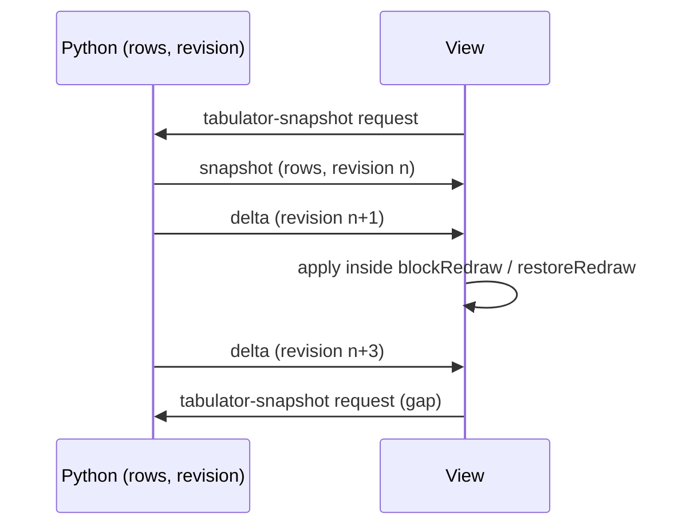

## Context

anylumino ships three widget families. Each is an esbuild bundle listed in
`scripts/bundle-entries.mjs`, and each widget class sets `_esm` to a small loader and `_bundle` to
the bundle, which `SharedBundleWidget` (`src/anylumino/common.py`) sends once per page on an
`anylumino-bundle` request. The native pickers (`src/anylumino/controls.py`,
`static/controls/native_control_widget.js`) are the closest pattern: plain DOM, no React, listeners
registered through `modelListeners` and `combineSignals` from `static/layout/composition.js`.

Tabulator 6.7.1 is a framework-free grid with a virtual DOM renderer. Findings from its source
(`MiscRepos/tabulator`, identical to the npm release):

- `replaceData`, `updateData`, `addData`, `updateOrAddData`, and `deleteRow` change rows in place;
  `blockRedraw` and `restoreRedraw` batch the repaint (`src/js/core/Tabulator.js`).
- The `ResizeTable` module watches the table element with a `ResizeObserver` and an
  `IntersectionObserver` and redraws when a hidden table becomes visible.
- Popups (menus, editor lists, tooltips) append to `document.body` unless `popupContainer` is set
  (`src/js/core/tools/Popup.js:69`).
- Every option that takes a named built-in also takes a function (`Format.js:62`,
  `Validate.js:222`).
- Date formatters, sorters, and editors look up luxon through the `dependencies` option
  (`src/js/core/defaults/options.js:65`).
- The SCSS uses Sass variables only; the built CSS has no custom properties.

## Goals / Non-Goals

**Goals:**

- A grid that stays responsive with 100,000 rows and takes row deltas at 10 Hz or more.
- A Python API that uses Tabulator's own option and column names, so its documentation applies.
- Correct rows in every view: a rerun cell, a second view of the same widget, and a marimo remount.
- Working inside every layout panel, in JupyterLab and in marimo's shadow root.

**Non-Goals:**

- Replacing or changing `ax.Table`.
- Server-side sorting, filtering, or pagination. The browser holds all rows.
- A typed Python wrapper for each Tabulator option.
- Tabulator's Ajax, Print, and Download modules as tested features. They ship in `TabulatorFull`
  but this change does not test or document them.

## Decisions

### D1: Tabulator from npm, the clone as reference

Pin `tabulator-tables` to `6.7.1` in `package.json` and import `TabulatorFull` from its ESM build.
`MiscRepos/tabulator` has no local patches and no `dist/`, and building it needs its own Rollup and
Sass toolchain. The license generator reads the notice from `node_modules`, as for every other
bundled package. Building from the clone becomes worthwhile only when a patch is needed.

### D2: One class, Tabulator's names

`al.Tabulator(data=None, columns=None, *, index="id", options=None, selected=(), transport=...,
width=None, height=None, callbacks=None, action_callbacks=None)` on `ActivationCallbacks` and
`SharedBundleWidget`. `columns` holds Tabulator column definitions and `options` holds any other
constructor option, both passed through. Without `columns` the widget sets `autoColumns`. Wrapping
each option as a keyword would copy a large, moving API; the pass-through keeps Tabulator's
documentation valid.

Synced traits: `columns`, `options`, `index`, `selected`, `width`, `height`. `data` is a Python
property, not a trait (D3).

`data` accepts a list of row mappings, or an object with `to_dict("records")` or
`__arrow_c_stream__`, so pandas and polars work without becoming dependencies.

### D3: Rows travel as messages, with a revision

A synced `data` trait resends every row on each change and is stored in the widget state a second
time. Instead Python owns the rows and a revision counter:

- Each view requests a snapshot when it renders, the same request and reply shape as
  `anylumino-bundle`.
- `update_rows`, `add_rows(rows, top=False)`, `upsert_rows`, and `delete_rows(ids)` patch the
  Python rows, add one to the revision, and send one delta message.
- A view applies a delta only when its revision is the view's revision plus one. On a gap it drops
  the delta and requests a snapshot. Deltas that arrive before the first snapshot are dropped, since
  the snapshot includes them.
- Assigning `table.data` replaces the rows and sends a snapshot to every view, applied with
  `replaceData` so scroll position and sort survive.
- The view queues deltas and applies the queue once per animation frame with `coalesce` from
  `composition.js`, inside `blockRedraw` and `restoreRedraw`.

Python keeps the rows in a dict keyed by the `index` field, so a delta is O(changed rows). Every
row must carry a unique `index` value; a duplicate or missing one raises `ValueError` and changes
nothing. When no row of the initial data has the `index` field, the widget assigns sequential ids
under that field.

A widget that needs the kernel for its data shows nothing in a static HTML export. That is already
true of every `SharedBundleWidget`, which needs the kernel for its code.

**Alternative considered:** a synced `data` trait plus delta messages. It needs both paths kept
consistent and still resends everything when Python assigns the trait.

### D4: Arrow IPC for snapshots and added batches

JSON encoding of 100,000 rows is slow in the kernel and large on the wire. Snapshots and `add_rows`
batches go as one Arrow IPC stream in the message `buffers` when both hold:

- the input is columnar (pandas, polars, a pyarrow table, or anything with `__arrow_c_stream__`);
- `pyarrow` imports.

Otherwise they go as JSON. `transport` takes a `Transport` enum (`AUTO`, `JSON`, `ARROW`);
`ARROW` raises `ImportError` without `pyarrow`. `update_rows`, `upsert_rows`, and `delete_rows`
always use JSON, since they carry few rows.

The browser decodes with `@uwdata/flechette` (BSD-3-Clause), which is far smaller than
`apache-arrow`, into row objects. Tabulator stores row objects, so Arrow reduces kernel time and
wire size, not browser memory. Task 3.4 measures both transports and the bundle growth; if Arrow
does not win at 100,000 rows the phase is dropped and reported.

With Arrow transport, Python keeps the columnar source and builds the row dict lazily, on the first
delta or `data` read, so a table that is only displayed never pays for row conversion.

Measured on 2026-11-11 (task 3.4) with a pandas DataFrame of 100,000 rows by 20 columns (8 float,
6 integer, 4 string, 1 timestamp, 1 boolean), on macOS, JupyterLab, and headless Chromium. Kernel
time covers widget construction and snapshot encoding; first paint runs from the kernel request
to the first rendered cell.

| Transport | Kernel time | Message size | First paint |
| --------- | ----------- | ------------ | ----------- |
| JSON      | 655 ms      | 39.7 MB      | 4.6 s       |
| Arrow     | 77 ms       | 17.6 MB      | 0.96 s      |

Flechette adds 25.8 KB (21.6 KB plus its `@uwdata/wk-geojson` dependency) to a 562 KB minified
bundle, 140 KB gzipped. Arrow stays.

### D5: `al.JsCode` and its wire form

`al.JsCode(source)` holds JavaScript function source. It serializes as `{"$js": source}` anywhere
inside `columns` or `options`. The view walks both structures and replaces each such object with
the function that the source evaluates to. A source that fails to evaluate, or does not evaluate to
a function, shows a load error naming the option path, and the table does not build.

Python also accepts the wire form itself as input: a mapping with the single key `$js` and a string
value is a `JsCode`. This lets workbench programs, whose values are JSON literals written by
`repr`, carry functions with no change to `codegen.py`.

The name follows `st-aggrid` and `itables`, which use `JsCode` for the same purpose.

### D6: Events

| Browser event         | Python effect                                                                  |
| --------------------- | ------------------------------------------------------------------------------ |
| `rowSelectionChanged` | Sets `selected` to the index values; runs `on_select` callbacks                |
| `cellEdited`          | Patches the Python row, adds one to the revision, runs `on_edit` callbacks     |
| `rowClick`            | Runs `on_click`; runs `on_action` with the row mapping                         |

`on_edit` callbacks receive the widget and an `Edit` dataclass with `row_id`, `field`, `value`, and
`old_value`. An edit is rebroadcast as a delta that carries the origin view's id; the origin view
advances its revision without reapplying it. Assigning `selected` from Python selects those rows in
every view. An index value in `selected` that no row has is dropped.

### D7: Hosting

- The view sets `popupContainer` to the widget root when `el.getRootNode()` is a `ShadowRoot`, so
  menus and editor lists get the widget CSS in marimo. In a plain document it leaves the default.
- Resizing and hidden tabs rely on Tabulator's `ResizeTable` module. `notifyNodeVisible` in
  `composition.js` stays unchanged unless the browser test in task 2.5 shows a stale layout.
- `height` defaults to `"320px"`: Tabulator's virtual renderer needs a bounded height. Inside a
  layout or tab panel slot the widget fills the slot and ignores `width` and `height`, because a
  fixed height taller than the slot hides the rows below its bottom edge. In a scroll box or a
  `fit_content` panel, where slots take their child's size, it keeps its own size.
- With no `columns`, Tabulator builds columns from the first row only on `setData`. A snapshot
  whose fields differ from the current columns therefore uses `setData`; every other snapshot uses
  `replaceData`, which keeps scroll and sort.
- The view calls `table.destroy()` when the render signal aborts.

### D8: Theming

Ship `tabulator-tables/dist/css/tabulator_simple.css` followed by a small override layer in
`static/tabulator/tabulator_widget.css` that maps colors to the JupyterLab variables
(`--jp-layout-color*`, `--jp-ui-font-color*`, `--jp-border-color*`), then to marimo's
(`--background`, `--foreground`, `--muted`, `--border`, `--primary`), then to light fallbacks.
JupyterLab's dark theme changes the `--jp-*` values, so no separate dark block is needed. A
`prefers-color-scheme` block was tried and dropped: in marimo it turned the grid dark on a light
page. Adding `sass` to compile a custom theme would add a build dependency for the same result.

### D9: Dates

Bundle `luxon` 3.7.2 and pass `dependencies: {DateTime}` to the Tabulator constructor, so no global
is set. `json_value` in `common.py` converts `date`, `time`, and `datetime` cells to ISO 8601
strings on the JSON path. On the Arrow path, timestamp and date columns decode to ISO strings in
the view so both transports give equal rows.

### D10: Workbench catalog

Add `Component("Tabulator", "al", "Tabulator", ...)` with props `data` and `columns` and the
generated options prop. `make workbench-skill` writes its skill page, which documents the `$js`
form. Programs may carry JavaScript functions (D5), by the user's decision. Callbacks reach row
deltas through `self.ui.<name>.update_rows(...)`.

## Risks / Trade-offs

- **An agent-written program runs JavaScript in the page** -> Accepted by the user. The skill page
  and the workbench documentation state it.
- **Tabulator popups or drag handlers misbehave in a shadow root** (`MoveRows` and `ResizeColumns`
  listen on `document.body`) -> The marimo check in task 2.6 covers column resize and a header
  menu; defects are fixed in the view or listed in the documentation as limits.
- **Arrow does not beat JSON after row-object conversion** -> Task 3.4 measures before the phase is
  kept.
- **Bundle size** (Tabulator, luxon, flechette in one bundle) -> The loader fetches it only on
  pages with a `Tabulator`. Task 3.4 reports the size.
- **A delta lost between kernel and browser** -> The revision check turns it into a snapshot
  request.
- **High-rate deltas flood the comm channel** -> Python sends one message per call; batching rows
  per call is the caller's job, and the streaming notebook shows it. The view coalesces repaints.
- **Option changes rebuild the table and lose scroll and sort state** -> Only `options` and `index`
  changes rebuild; `columns` uses `setColumns` and data changes never rebuild.

## Migration Plan

Additive. No existing API changes. Release as a minor version with a changelog entry.

## Open Questions

None. Arrow transport stays or goes on the measurement in task 3.4.
